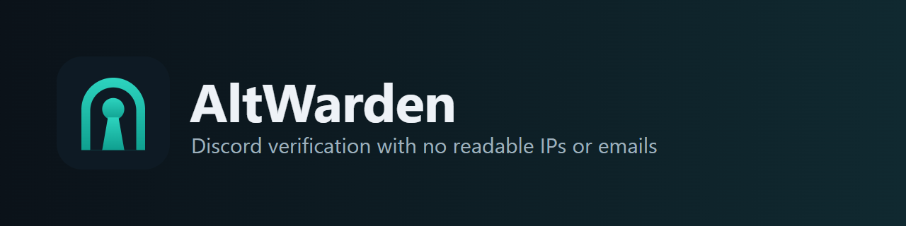

<p align="center">
  
</p>

<p align="center">
  <a href="https://github.com/hifihedgehog/AltWarden/actions/workflows/tests.yml"></a>
  <a href="LICENSE"></a>
  
  
</p>

AltWarden is a self-hosted Discord verification bot with a web dashboard. It checks new members for alt accounts, ban evasion, VPNs and raids, and it stores no readable IP addresses, emails, cookies, fingerprints or Discord tokens.

In October 2026 the verification bot Double Counter said an attacker may have reached records on about 28 million Discord accounts, including about 27 million IP addresses. [Have I Been Pwned](https://haveibeenpwned.com/Breach/DoubleCounter) lists about 275,000 email addresses from the leak. Verification bots collect that data because they need it for a moment. AltWarden uses it for that moment and keeps a keyed hash instead, under a separate key for every server.

## What a stolen database would give an attacker

| They would get | They would not get |
|---|---|
| Discord IDs, usernames and avatars of people who verified | Any IP address, email address, cookie value or fingerprint |
| Attempt results and labels | Any Discord access or refresh token |
| Keyed hashes they can't read without the key | A way to connect one person's hashes across two servers |

The [security page](altwarden/web/static/security.html) lists how that works and where it stops working. A full takeover of the server, with both the database and the key, defeats the hashing. Browser checks run in the member's browser, so a custom client can forge them.

## At a glance

| | |
|---|---|
| Source code | Public, MIT |
| Raw IPs and fingerprints at rest | None |
| Discord tokens at rest | None |
| Ads on the verification page | None |
| Outside scripts on the verification page | None |
| Works with an ad blocker on | Yes |
| Forced wait on the verification page | None |
| A rule that records without blocking | The Watch action |
| Alt matching | Weighs evidence, and shows staff how strong a match is |
| Alts of banned accounts | Their own action |
| Raid mode | Automatic, from the join rate |
| Appeals | From the result page, decided with buttons in Discord |
| Settings changes | Logged with before and after values |
| Data deletion | Self-service |
| Needs Administrator | No |
| Webhooks and API | Signed webhooks, and read-only API keys |
| Languages for members | English, German, Spanish, French, Japanese, Korean, Portuguese, Russian, Chinese |

## What it checks

| Group | Checks |
|---|---|
| Account | Account age, profile picture, two-factor login, throwaway email, alt accounts, attempt limit |
| Network | VPN, proxy, Tor, Apple Private Relay, data centers, mobile data, country rules |
| Browser | Automation, anti-detect browsers, tampering, fake identity, developer tools, private windows, fingerprint blocking, bot and suspect scores |
| Device | Virtual machines, emulated phones, phones whose model doesn't fit their hardware |

Each check can Watch, Deny, Kick or Ban. Every enabled check runs on every attempt, and the strongest action wins.

Browser checks use published open-source work, served from your own site: [FingerprintJS](https://github.com/fingerprintjs/fingerprintjs), [BotD](https://github.com/fingerprintjs/BotD) and [detectIncognito](https://github.com/Joe12387/detectIncognito). The tamper checks follow [CreepJS](https://github.com/abrahamjuliot/creepjs). Network data comes from [open lists](THIRD_PARTY.md), searched in memory, so no address leaves your server unless a server owner turns on the optional outside lookup.

## Staff tools

Logs per check, role alerts, a help desk with private threads, appeals, bypass links, a honeypot channel, per-page and per-command access rules, Discord's own command permissions, analytics, a health report that works out the smallest permissions your settings need, and an audit log. Each server can set AltWarden's picture, name, bio, and name font and effect there.

Discord doesn't publish the name style fields in its reference. They come from [Discord Userdoccers](https://github.com/discord-userdoccers/discord-userdoccers), so a change on Discord's side could stop them working. If Discord refuses a style, the page says so and the rest still saves.

## Host it yourself

You need Python 3.11 or newer and a reverse proxy with HTTPS.

1. Create an application in the [Discord Developer Portal](https://discord.com/developers/applications). Turn on **Server Members Intent**, and leave Presence and Message Content off. Add these OAuth2 redirects, with your own address:
   ```
   https://your.site/verify/callback
   https://your.site/dashboard/callback
   ```
2. Install it:
   ```sh
   git clone https://github.com/hifihedgehog/AltWarden.git
   cd AltWarden
   python -m venv venv && . venv/bin/activate
   pip install -r requirements.txt
   python -m altwarden.keygen
   cp .env.example .env
   chmod 600 .env
   ```
   Put the printed key in `.env` as `MASTER_KEY`, with your bot token and client secret. Back up the key on its own. Losing it makes every stored hash unmatchable.
3. Run it:
   ```sh
   python -m altwarden --public-url https://your.site --port 8892
   ```
   It listens on `127.0.0.1` and downloads its network lists on the first run. `altwarden.service` is a hardened systemd unit.
4. Point your proxy at that port, have it add the client address as the last value of `X-Forwarded-For`, which is the only value AltWarden reads, and **turn off the proxy's access log or remove the client address from it**. Otherwise raw addresses end up in your web logs.

Run the tests with `python -m unittest discover -s tests`. `python scripts/browser_check.py` drives the real pages in headless Edge or Chrome, and changes every control on the Rules, Messages and Access pages to prove it saves. `python scripts/detector_controls.py` and `python scripts/engine_controls.py` run the browser checks on real Chromium, Firefox and WebKit, clean and with what each check should catch.

## Commands

`/setup`, `/settings`, `/post-message`, `/health`, `/verify-user`, `/reset-user`, `/create-bypass`, `/lookup`, `/trust-accounts`, `/import-members`, `/raid`, `/uninstall`, `/my-data`, `/help` and `/ping`. Right-click a member for Verify, Reset, Create Bypass and Lookup. The [docs page](altwarden/web/static/docs.html) covers each one.

## License

MIT. See [LICENSE](LICENSE) and [THIRD_PARTY.md](THIRD_PARTY.md).
